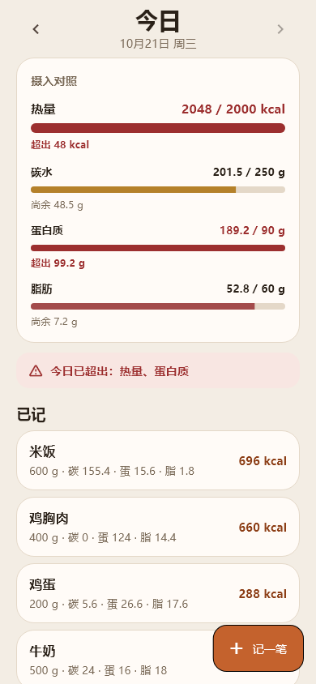
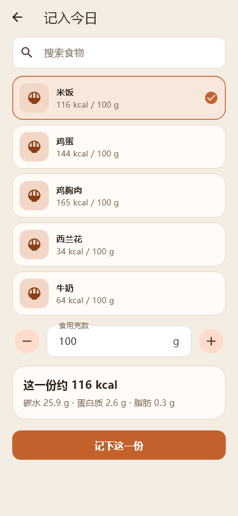
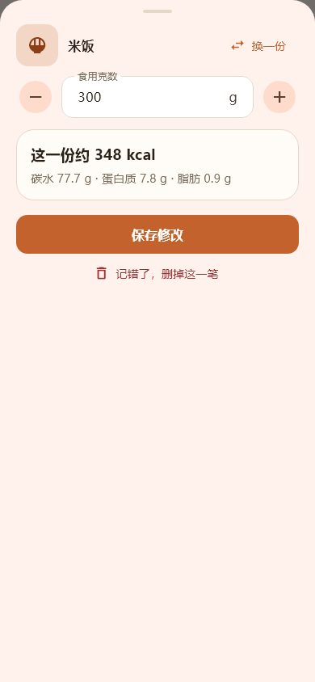
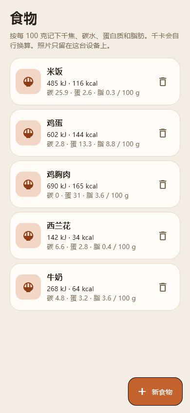
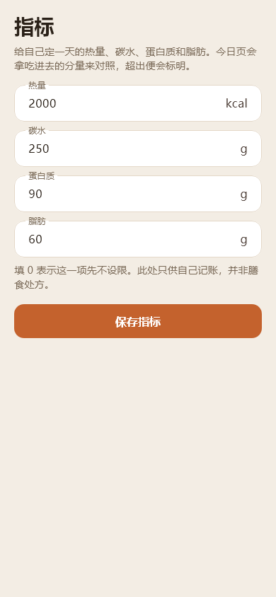

<div align="center">


# kcal · 热量账本

本地优先的饮食记录 Flutter 应用：从食物库里挑一份吃的，填上克数记入当日，随时回看热量与三大营养素是否超标。

**Android · iOS · Web · Windows**

</div>

## 截图

| 今日 | 记一笔 | 编辑记录 |
|---|---|---|
|  |  |  |

| 食物库 | 指标 |
|---|---|
|  |  |

## 功能

- **今日**：按日记录，对照热量 / 碳水 / 蛋白质 / 脂肪指标，超标会提醒
- **记一笔**：从食物库选食物、填克数，实时预览这一份的热量
- **改记录**：记错了点开已记的记录即可改克数、换成别的食物，或删掉
- **可撤销**：左滑撤下记录后，底部提示可在几秒内撤销，误删也能找回
- **食物库**：自建食物（每 100 克的千焦与三大营养素），支持拍照或相册图片
- **指标**：设置每日热量与三大营养素目标

## 运行

```bash
flutter pub get
flutter run
```

数据用 [sembast](https://pub.dev/packages/sembast) 存在本地（移动端文件、Web 端 IndexedDB），不上传任何数据。

## 打包 APK

```bash
flutter build apk --release
```

## 测试与截图

```bash
flutter test                        # 单元与组件测试
flutter test test/screenshots_test.dart --dart-define=screenshots=true   # 重新生成 README 截图
```

应用图标源文件在 `assets/icon/`（SVG），平台 PNG 由它渲染生成。
